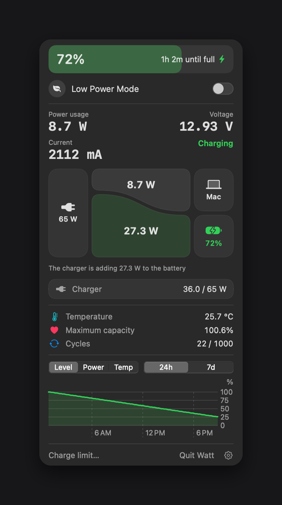

# Watt

[English](README.md) | [한국어](README.ko.md) | Deutsch | [日本語](README.ja.md)



Eine Menüleisten-App für die Batterie von MacBooks mit Apple Silicon. Watt zeigt Ladestand, Energiefluss, Temperatur, Batteriezustand und Verlaufsdiagramme und schaltet den Stromsparmodus direkt in der Menüleiste ein und aus.

## Voraussetzungen

- MacBook mit Apple Silicon
- macOS 14 oder neuer

Entwickelt auf einem M5 MacBook mit macOS 27. Auf anderen Modellen werden die Temperatur oder einzelne Leistungswerte eventuell nicht angezeigt.

## Installation

1. Lade `Watt.dmg` unter Releases herunter.
2. Bewege `Watt.app` in den Ordner `Programme` und öffne die App.
3. Watt ist nicht notarisiert, deshalb kann macOS den ersten Start blockieren. Öffne Systemeinstellungen > Datenschutz & Sicherheit und wähle Dennoch öffnen.

Watt hat kein Dock-Symbol. Die App erscheint in der Menüleiste.

## Sprache

Watt ist auf Englisch, Koreanisch, Deutsch und Japanisch verfügbar. Die App folgt der Sprache deines Macs und verwendet sonst Englisch. Du kannst die Sprache über das Zahnrad im Panel auswählen.

## Berechtigung für den Stromsparmodus

macOS verlangt Administratorrechte, um den Stromsparmodus zu ändern. Beim ersten Einschalten erscheint einmalig eine Passwortabfrage, und diese Regel wird unter `/etc/sudoers.d/watt-lowpower` installiert:

```
<user> ALL=(root) NOPASSWD: /usr/bin/pmset -a lowpowermode 0, /usr/bin/pmset -a lowpowermode 1
```

Nur diese beiden Befehle laufen ohne Passwort. Watt erhält oder speichert dein Passwort nie, und ohne diese Funktion wird nichts installiert.

## Deinstallation

Wähle das Zahnrad im Panel und dann Watt vollständig entfernen. Dadurch werden Berechtigung, Starteinstellungen und Verlauf gelöscht, und die App wandert in den Papierkorb.

Wenn du die App stattdessen in den Papierkorb gezogen hast, entfernen diese Befehle die Reste:

```bash
sudo rm -f /etc/sudoers.d/watt-lowpower
launchctl bootout gui/$(id -u)/local.watt.menubar 2>/dev/null
rm -f ~/Library/LaunchAgents/local.watt.menubar.plist
rm -rf ~/Library/Application\ Support/Watt
```

## Erstellen

Erfordert Xcode.

```bash
./build.sh
./make-dmg.sh
./demo.sh
```

`build.sh` erstellt `Watt.app`, `make-dmg.sh` erstellt `dist/Watt.dmg`, und `demo.sh` simuliert Stromzustände, damit du die Ansichten ohne Netzteil prüfen kannst.

## Hinweise

- macOS aktualisiert die Leistungswerte etwa einmal pro Minute.
- Der SMC wird nur zum Lesen der Temperatur verwendet. Watt steuert das Laden nicht. Nutze stattdessen das in macOS integrierte Ladelimit.

## Lizenz

MIT
