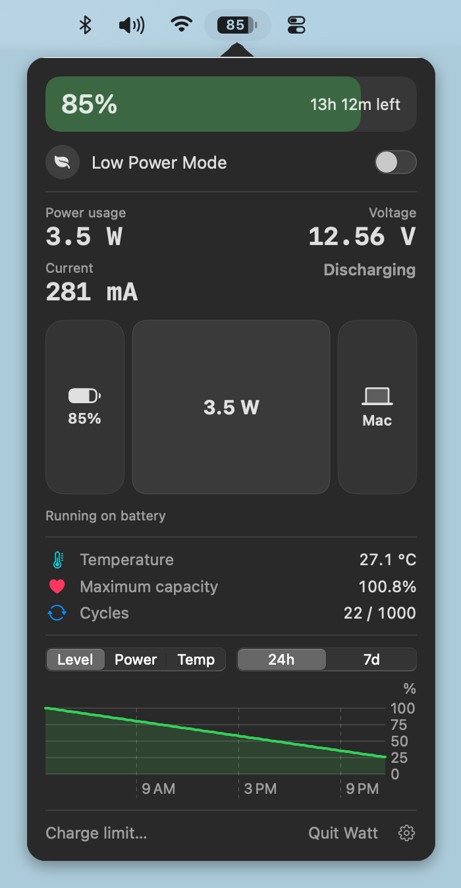

# Watt

[English](README.md) | [한국어](README.ko.md) | [Deutsch](README.de.md) | 日本語



Appleシリコン搭載MacBook向けのメニューバー用バッテリーアプリです。バッテリー残量、電力の流れ、温度、バッテリーの状態、履歴グラフを表示し、メニューバーから低電力モードのオン/オフを切り替えられます。メニューバーのバッテリーアイコンをクリックするとパネルが開きます。

## 動作環境

- Appleシリコン搭載MacBook
- macOS 14以降

macOS 27を搭載したM5 MacBookで開発しています。ほかの機種では、温度や一部の電力値が表示されない場合があります。

## インストール

1. Releasesから`Watt.dmg`をダウンロードします。
2. `Watt.app`を`アプリケーション`フォルダに移動して開きます。
3. Wattは公証を受けていないため、初回起動時にmacOSがブロックすることがあります。システム設定 > プライバシーとセキュリティで「このまま開く」を選択してください。

WattにDockアイコンはありません。メニューバーに表示されます。

## 言語

英語、韓国語、ドイツ語、日本語に対応しています。Macの言語に従い、対応していない言語の場合は英語で表示します。パネルの歯車アイコンから言語を選ぶこともできます。

## 低電力モードの権限

macOSでは低電力モードの変更に管理者権限が必要です。スイッチを初めてオンにすると、パスワードの確認が一度だけ表示され、次のルールが`/etc/sudoers.d/watt-lowpower`にインストールされます。

```
<user> ALL=(root) NOPASSWD: /usr/bin/pmset -a lowpowermode 0, /usr/bin/pmset -a lowpowermode 1
```

パスワードなしで実行されるのはこの2つのコマンドだけです。Wattがパスワードを受け取ったり保存したりすることはなく、この機能を使わない限り何もインストールされません。

## アンインストール

パネルの歯車アイコンを選択し、「Wattを完全に削除」を選びます。権限、自動起動の設定、履歴が削除され、アプリはゴミ箱に移動します。

アプリを直接ゴミ箱に入れた場合は、次のコマンドで残りを削除できます。

```bash
sudo rm -f /etc/sudoers.d/watt-lowpower
launchctl bootout gui/$(id -u)/local.watt.menubar 2>/dev/null
rm -f ~/Library/LaunchAgents/local.watt.menubar.plist
rm -rf ~/Library/Application\ Support/Watt
```

## ビルド

Xcodeが必要です。

```bash
./build.sh
./make-dmg.sh
./demo.sh
```

`build.sh`は`Watt.app`を、`make-dmg.sh`は`dist/Watt.dmg`を作成します。`demo.sh`は電源の状態をシミュレートするので、充電器がなくても画面を確認できます。

## 補足

- macOSが電力値を更新するのは約1分に1回です。
- SMCは温度の読み取りにのみ使用します。Wattは充電を制御しません。代わりにmacOS標準の充電上限を使ってください。

## ライセンス

MIT
