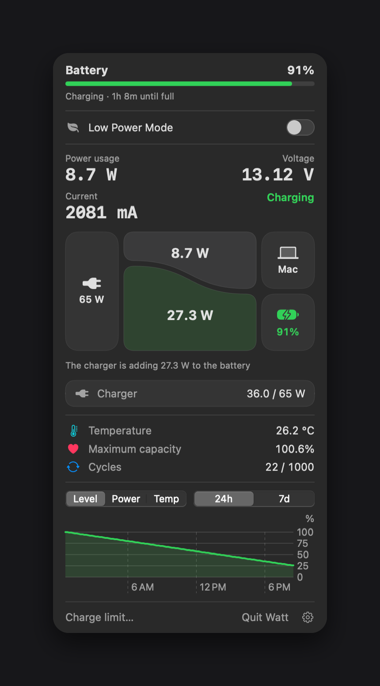

# Watt

[English](README.md) | 한국어



Apple Silicon 맥북용 메뉴바 배터리 앱입니다. 잔량, 전력 흐름, 온도, 배터리 수명, 기록 그래프를 보여주고 메뉴바에서 저전력 모드를 켜고 끌 수 있습니다.

## 요구 사항

- Apple Silicon 맥북
- macOS 14 이상

M5 MacBook, macOS 27에서 개발했습니다. 다른 기기에서는 온도나 일부 전력 값이 표시되지 않을 수 있습니다.

## 설치

1. Releases에서 `Watt.dmg`를 받습니다.
2. `Watt.app`을 `Applications`로 옮기고 실행합니다.
3. 공증되지 않은 앱이라 처음 실행이 차단될 수 있습니다. 시스템 설정 > 개인정보 보호 및 보안에서 `그래도 열기`를 누르세요.

앱은 창 없이 메뉴바에 나타납니다.

## 언어

한국어와 영어를 지원합니다. 기본값은 맥 언어를 따르며, 한국어가 아니면 영어로 표시합니다. 패널의 톱니바퀴에서 직접 고를 수 있습니다.

## 저전력 모드 권한

macOS는 저전력 모드를 바꿀 때 관리자 권한을 요구합니다. 스위치를 처음 켜면 맥 비밀번호 창이 한 번 뜨고, 다음 규칙이 `/etc/sudoers.d/watt-lowpower`에 설치됩니다.

```
<사용자> ALL=(root) NOPASSWD: /usr/bin/pmset -a lowpowermode 0, /usr/bin/pmset -a lowpowermode 1
```

저전력 모드 켜기/끄기 두 명령만 비밀번호 없이 실행됩니다. 앱은 비밀번호를 받거나 저장하지 않습니다. 이 기능을 쓰지 않으면 설치되지 않습니다.

## 삭제

패널의 톱니바퀴 > `Watt 완전 삭제`를 누르세요. 권한, 자동 실행 설정, 기록을 지우고 앱을 휴지통으로 보냅니다.

앱을 그냥 휴지통에 버렸다면 다음 명령으로 남은 항목을 지울 수 있습니다.

```bash
sudo rm -f /etc/sudoers.d/watt-lowpower
launchctl bootout gui/$(id -u)/local.watt.menubar 2>/dev/null
rm -f ~/Library/LaunchAgents/local.watt.menubar.plist
rm -rf ~/Library/Application\ Support/Watt
```

## 빌드

Xcode가 필요합니다.

```bash
./build.sh
./make-dmg.sh
./demo.sh
```

`build.sh`는 `Watt.app`을, `make-dmg.sh`는 `dist/Watt.dmg`를 만듭니다. `demo.sh`는 충전 상태를 흉내 내어 화면을 확인합니다.

## 알아둘 점

- 전력 값은 macOS가 약 1분마다 갱신합니다.
- SMC는 온도를 읽을 때만 사용하며, 충전을 직접 제어하지 않습니다. 충전 한도는 macOS 기본 기능을 사용합니다.

## 라이선스

MIT
