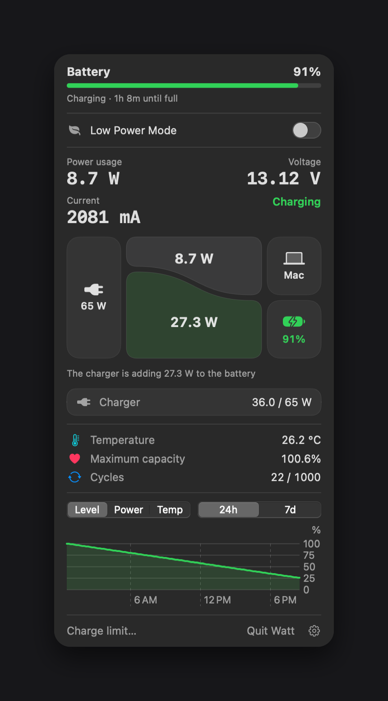

# Watt

English | [한국어](README.ko.md)



A menu bar battery app for Apple silicon MacBooks. Watt shows battery level, power flow, temperature, battery health, and history charts, and lets you turn Low Power Mode on and off from the menu bar.

## Requirements

- Apple silicon MacBook
- macOS 14 or later

Developed on an M5 MacBook running macOS 27. Temperature or some power values may not appear on other models.

## Install

1. Download `Watt.dmg` from Releases.
2. Move `Watt.app` to `Applications` and open it.
3. Watt isn't notarized, so macOS may block the first launch. Go to System Settings > Privacy & Security and choose Open Anyway.

Watt has no Dock icon. It appears in the menu bar.

## Language

Watt is available in English and Korean. It follows your Mac's language and uses English unless that language is Korean. You can pick a language under the gear icon in the panel.

## Low Power Mode permission

macOS requires administrator rights to change Low Power Mode. The first time you turn on the switch, a password prompt appears once and this rule is installed at `/etc/sudoers.d/watt-lowpower`:

```
<user> ALL=(root) NOPASSWD: /usr/bin/pmset -a lowpowermode 0, /usr/bin/pmset -a lowpowermode 1
```

Only those two commands run without a password. Watt never receives or stores your password, and nothing is installed unless you use this feature.

## Uninstall

Select the gear icon in the panel, then choose Completely remove Watt. This removes the permission, launch settings, and history, and moves the app to the Trash.

If you dragged the app to the Trash instead, these commands remove what's left:

```bash
sudo rm -f /etc/sudoers.d/watt-lowpower
launchctl bootout gui/$(id -u)/local.watt.menubar 2>/dev/null
rm -f ~/Library/LaunchAgents/local.watt.menubar.plist
rm -rf ~/Library/Application\ Support/Watt
```

## Build

Requires Xcode.

```bash
./build.sh
./make-dmg.sh
./demo.sh
```

`build.sh` creates `Watt.app`, `make-dmg.sh` creates `dist/Watt.dmg`, and `demo.sh` simulates power states so you can check the screens without a charger.

## Notes

- macOS refreshes power values about once a minute.
- The SMC is used only to read temperature. Watt doesn't control charging. Use the built-in macOS charge limit instead.

## License

MIT
